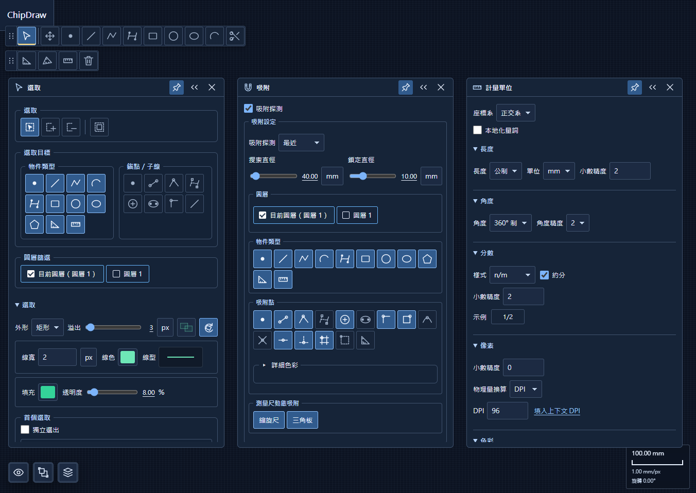

# ChipChip · ChipDraw 繪圖工作區

ChipDraw 是可離線使用的向量畫板，支援以圖層編輯幾何物件、吸附定位和精確計量。下載最新版的 **ChipDraw.html**，用瀏覽器開啟即可使用。已下載的舊檔案需要重新下載才能看到新版窗格。[下載離線畫板](https://github.com/nurtasihram/ChipChip/raw/refs/heads/main/ChipDraw.html)



## 窗格操作

畫板開啟時，「視圖」、「物件」和「圖層」預設展開。「計量單位」、「吸附」和「選取」各自收合在畫板左下角。按對應圖示開啟，再按標題列的圖釘，就能像上圖一樣同時使用三個窗格。標題列右側依序是釘選、收縮和關閉。收合後保留各自的圖示，按一下即可還原。

| 窗格 | 可以做什麼 |
| --- | --- |
| 選取 | 設定重選、增選、消選、框選方式、可選物件與錨點，以及選區外觀。 |
| 吸附 | 開啟探測，選擇探測模式、搜索與鎖定直徑、目標圖層及吸附點。 |
| 計量單位 | 設定長度與角度單位、精度、分數顯示、像素換算和本地化量詞。 |
| 視圖 | 調整相機、格線、原點、比例尺與座標系指示器。 |
| 物件 | 檢視及編輯選取物件的幾何、樣式、圖層與 JSON 模型。 |
| 圖層 | 新增、重新命名、排序、隱藏或鎖定圖層，選擇目前繪圖的圖層。 |

要試畫矩形，先選繪圖工具列的矩形工具和對角點畫法，再依序點選兩角。按 Esc 可取消預覽。[工作區操作指南](docs/guides/WORKSPACE.md) · [繪圖工具與手勢](docs/guides/DRAWING_TOOL_INTERACTIONS.md) · [GitHub Wiki](https://github.com/nurtasihram/ChipChip/wiki)

## 工程目錄

| 路徑 | 內容 |
| --- | --- |
| `ChipDraw.html`、`ChipChip.html`、`index.html` | 同一畫板的三個離線入口，由建置工具產生。 |
| [src/chipdraw](src/chipdraw/) | HTML 畫板、SVG 編輯及各工具的接入點。 |
| [shared](shared/) | 幾何查詢、計量換算、圖稿模型、窗格與輸入元件。 |
| [desktop/qt](desktop/qt/README.md) | 原生矩形編輯器、桌面啟動方式及相容性測試說明。 |
| [tests](tests/) | 核心測試入口及測試案例；瀏覽器測試在 `browser/`，測試用替身在 `fixtures/`。 |
| [tools](tools/) | 離線建置、桌面啟動及繪圖示範錄製工具。 |
| [docs](docs/) | `guides/` 操作指南、`reference/` 技術規格、`design-samples/` 設計樣本、`images/` 畫面及 `wiki/` Wiki 原稿。 |
| [vendor/monaco](vendor/monaco/) | 離線 JSON 編輯器資源與第三方授權。 |

## 建置與驗證

在專案根目錄執行下列命令。核心測試使用 Node.js。瀏覽器測試另需 Playwright 和 Chromium，可用 `CHIPDRAW_PLAYWRIGHT` 指定模組 URL、`CHIPDRAW_BROWSER` 指定瀏覽器執行檔。

```sh
node tools/build.mjs
node tests/run.mjs
node tests/run-browser.mjs
```

配置單位由 `units_system` 統一提供。物理長度在各系統的設定中以 mm 保存，輸入框、滑桿與標尺依目前單位換算顯示。換單位會更新顯示，並保留原來的幾何和物理長度。[資料類型與計算規範](docs/reference/DATA_TYPES_AND_CALCULATION.md) · [JSON 儲存規格](docs/reference/JSON_STORAGE.md) · [模型範例](docs/wiki/Model-examples.md)

版本沿革見 [變更紀錄](CHANGELOG.md)。本專案採用 [MIT 授權](LICENSE)。
