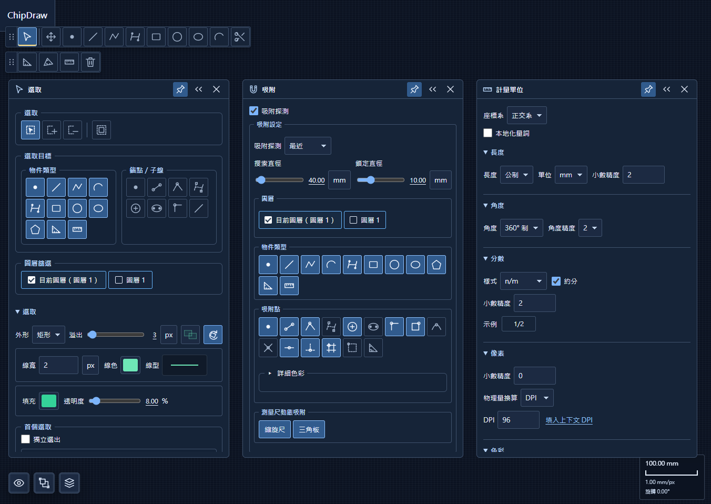

# 工作區操作指南

## 開啟和收合窗格

選取、吸附和計量單位各有專屬圖示。初次開啟畫板時，左下角由左至右依序是計量單位、吸附、選取。點一下圖示可以暫時展開窗格。要一邊作圖一邊保留窗格，按標題列右側的圖釘。暫時展開時，把焦點移到畫布或其他窗格便會收回。在窗格自己打開的選單或 JSON 編輯器內操作，可以繼續使用該窗格。

六個窗格共用同一組標題列和工具列操作。拖曳標題列可移動窗格，拖曳邊緣或角落可調整大小。收縮和關閉按鈕都會保留該窗格的還原圖示。圖示可以直接拖曳，也可以用 Tab 聚焦後按 Enter 或空白鍵開啟。視圖、物件、圖層亦使用相同操作。

## 選取與編輯

1. 從繪圖工具列啟用選取工具，在「選取」窗格選重選、增選或消選。以「內含」框選時，物件需完全位於框內。「外包」也選入與框相交的物件。
2. 在「選取目標」分別勾選物件與錨點類型。例如只想調整橢圓焦點，可選焦點並關閉物件類型。「目前圖層」跟隨作用中的圖層，亦可另外指定固定圖層。
3. 點選圖形或錨點後，到「物件」編輯座標、尺寸或樣式。物件支援的參數依類型而定；圓顯示半徑，橢圓提供長短軸與焦點。所選物件的 JSON 模型可在窗格底部展開。

## 吸附定位

開啟「吸附探測」後選擇「最近」或「附近所有」，並勾選需要的物件、圖層及吸附點。搜索直徑決定提示範圍，鎖定直徑決定指標何時落到目標。鎖定直徑為零時，會直接鎖定最近的有效吸附點。重疊候選可在畫布清單選取。

例如要吸附目前圖層內的端點，勾選「目前圖層」、對應的物件類型及端點，再移動指標到線段附近。選取與吸附各自保留圖層篩選，因此可以選取一層的物件，同時吸附另一層。

## 切換顯示單位

在「計量單位」選擇長度制與單位。吸附直徑使用物理長度時，原來的 40 mm 切換成 cm 後應顯示為 4 cm。點滑桿旁帶底線的數字可精確輸入，Enter 提交、Esc 取消。點選支援切換的單位按鈕，可選螢幕像素、上下文物理長度或該欄位支援的比例模式。像素換算、分數、精度和本地化量詞均在計量單位窗格設定。

## 工具列、圖層與繪圖

- 拖動工具按鈕可變更順序，首位是預設工具。具有多種畫法的工具會展開方式工具列。提示依實際使用的滑鼠、觸控、筆或鍵盤切換。
- 新圖形會加入目前圖層。點圖層名稱可重新命名，拖動名稱可排序。圖層列的顯示和鎖定按鈕可控制可見性與編輯。
- 拖動物件或錨點時，三角板會標示實際位移。縮旋尺可用來旋轉與縮放畫面；按 Esc 可取消預覽。

[各工具的手勢與完成方式](DRAWING_TOOL_INTERACTIONS.md) · [返回專案首頁](../../README.md)
