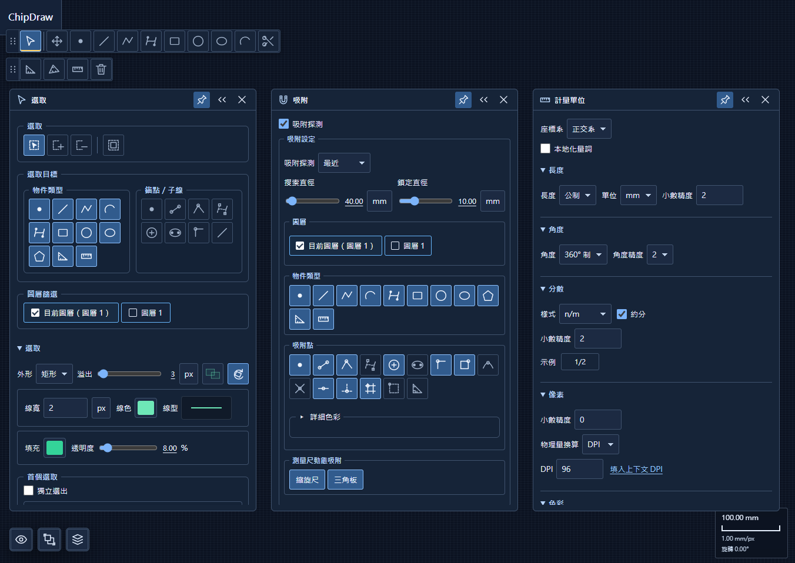

# ChipDraw 使用指南

下載最新版的 **ChipDraw.html**，用瀏覽器開啟即可離線繪圖。[下載畫板](https://github.com/nurtasihram/ChipChip/raw/refs/heads/main/ChipDraw.html)

## 找到選取、吸附與計量單位

畫板左下角有三個獨立入口，由左至右為計量單位、吸附、選取。點選圖示後，按標題列的圖釘可讓窗格保持展開。三者與圖層、物件共用相同的釘選、收縮、關閉及還原操作。下圖將三個窗格並排，視圖、物件和圖層已收合在左下角。

- **選取**可設定重選、增選、消選及框選方式，並篩選物件、錨點和圖層。
- **吸附**可設定搜索與鎖定直徑、吸附點與目標圖層。選擇物理長度模式時，單位會跟隨計量設定。
- **計量單位**管理長度、角度、分數、精度、像素換算和本地化量詞。例如把長度從 mm 改為 cm，40 mm 的搜索直徑會顯示為 4 cm。

## 操作指南與規格

- [工作區操作指南](https://github.com/nurtasihram/ChipChip/blob/main/docs/guides/WORKSPACE.md)
- [繪圖工具、手勢與預覽](https://github.com/nurtasihram/ChipChip/blob/main/docs/guides/DRAWING_TOOL_INTERACTIONS.md)
- [按鈕、語言和圖稿的 JSON 模型範例](https://github.com/nurtasihram/ChipChip/wiki/Model-examples)
- [資料類型與計算規範](https://github.com/nurtasihram/ChipChip/blob/main/docs/reference/DATA_TYPES_AND_CALCULATION.md)
- [JSON 儲存規格](https://github.com/nurtasihram/ChipChip/blob/main/docs/reference/JSON_STORAGE.md)
- [原生桌面矩形編輯器](https://github.com/nurtasihram/ChipChip/blob/main/desktop/qt/README.md)
- [版本變更紀錄](https://github.com/nurtasihram/ChipChip/blob/main/CHANGELOG.md)
